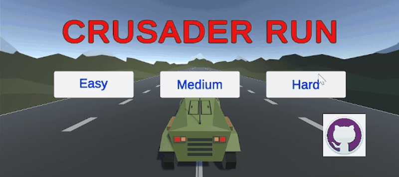
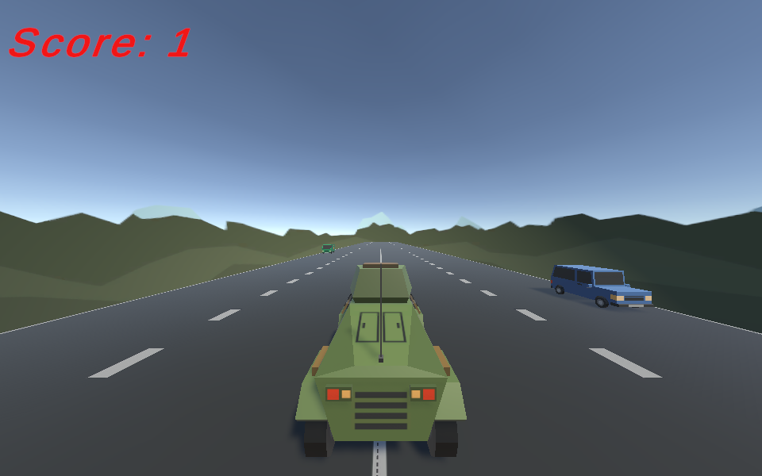

# Crusader Run

An endless driving game made in Unity. You steer an armoured car through oncoming traffic, and the game ends when you crash.

**[Play it in your browser](https://ben-cranley.github.io/crusader-run/play/)**

Second-year pair project, Interactive Multimedia, TU Dublin (2024). Built in Unity 2022.3 with C#.

## Gameplay

- Choose **Easy**, **Medium** or **Hard**. Harder levels spawn traffic faster.
- Steer left and right with the **arrow keys** or **A / D**. The car tilts as it turns.
- You score points for every car you get past.
- Hit a car and it's game over, with an explosion, a crash sound and a restart button.

## How it works

| Script | What it does |
|---|---|
| `PlayerController.cs` | Steering, keeps the car on the road, detects crashes |
| `SpawnManager.cs` | Spawns random cars in random lanes. The spawn rate is set by the difficulty |
| `GamesManager.cs` | Starts the game, tracks the score, handles game over and restart |
| `DifficultyButton.cs` | The Easy, Medium and Hard buttons on the title screen |
| `CarMovement.cs` | Drives the traffic towards the player |
| `DestroyOutOfBounds.cs` | Removes cars once they're past the player and adds to the score |
| `carTilt.cs` | Tilts the car into turns |
| `FollowPlayer.cs` | Keeps the camera behind the car |
| `linksGit.cs` | The GitHub button on the title screen |

The scripts are in [`Project-Beta/Assets/Scripts`](Project-Beta/Assets/Scripts).

## Running the project

1. Install Unity **2022.3.47f1** (any 2022.3 LTS version should work).
2. In Unity Hub, click **Add** and open the `Project-Beta` folder.
3. Open `Assets/Scenes/Project` and press **Play**.

The browser version is in [`docs/play`](docs/play) and is hosted with GitHub Pages.

## Credits

- Built from Unity's [Create with Code](https://learn.unity.com/course/create-with-code) course, with the code adapted for this game.
- The car tilt is based on a [Unity Discussions thread](https://discussions.unity.com/t/rotate-object-with-quaternion-euler-and-tilt-object/225419).
- Sounds: [Grenade Sound FX](https://assetstore.unity.com/packages/audio/sound-fx/grenade-sound-fx-147490) and [Fantasy Medieval Combat](https://assetstore.unity.com/packages/audio/music/orchestral/fantasy-medieval-combat-298404) from the Unity Asset Store.
